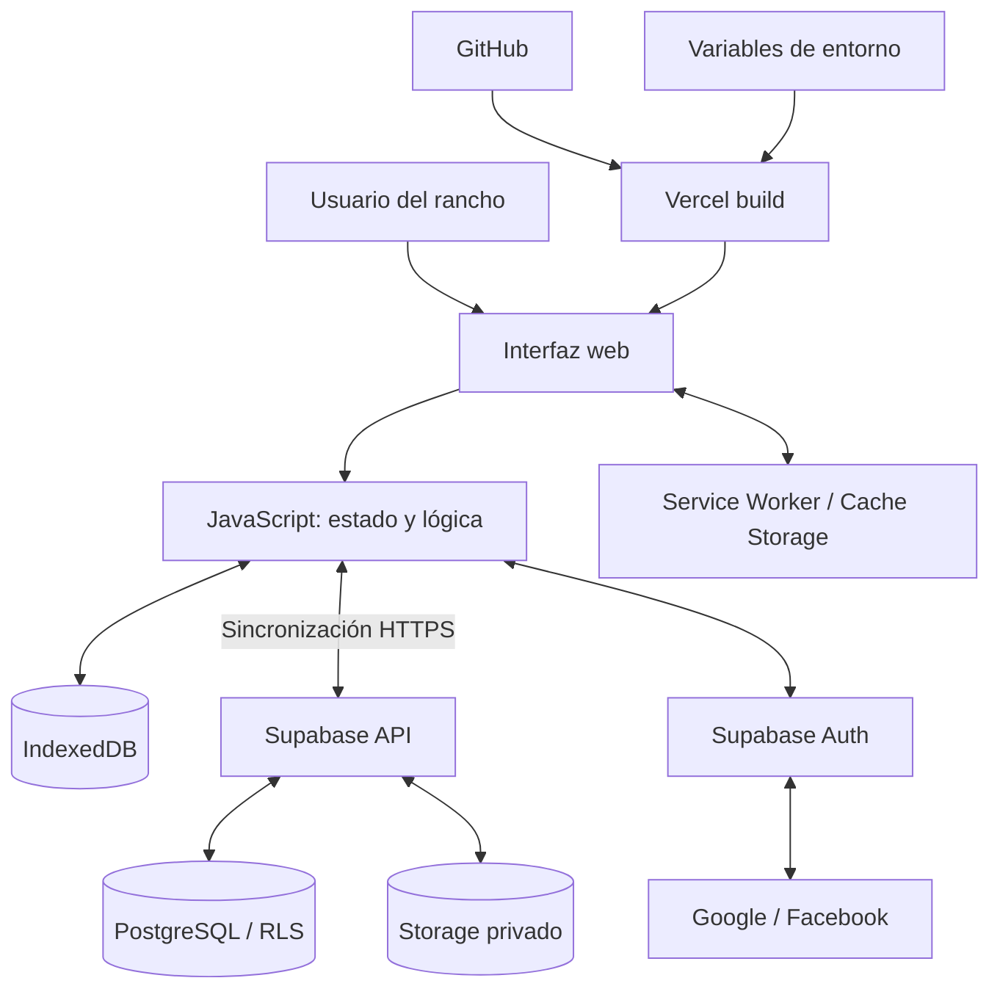

<div align="center">
  

  # Ganaderov

  **Gestión ganadera inteligente · Del campo a la nube**

  Aplicación web para registrar, organizar y analizar ganado bovino, diseñada para acompañar el trabajo cotidiano del rancho, incluso cuando la conexión es intermitente.

  [Abrir aplicación](https://ganaderov.vercel.app/) · [Documentación](#arquitectura) · [Reportar un problema](https://github.com/SkContreras/Ganaderov/issues)

  
  
  
  
  
  

  
</div>

## Acerca del proyecto

Ganaderov reúne el inventario, los expedientes individuales, las jornadas de manejo y las herramientas de análisis económico en un solo lugar. Su arquitectura prioriza el almacenamiento local y la sincronización posterior, para que la falta de cobertura en el campo no interrumpa la captura de datos.

## Contenido

- [Funcionalidades](#funcionalidades)
- [Interfaz](#interfaz)
- [Arquitectura](#arquitectura)
- [Estructura del repositorio](#estructura-del-repositorio)
- [Base de datos](#base-de-datos)
- [Instalación y configuración](#instalación-y-configuración)
- [Despliegue](#despliegue)
- [Seguridad y privacidad](#seguridad-y-privacidad)
- [Pruebas y mantenimiento](#pruebas-y-mantenimiento)
- [Contribuciones, autoría y agradecimientos](#contribuciones-autoría-y-agradecimientos)

## Funcionalidades

| Módulo | Capacidades |
| --- | --- |
| Inventario | Identificación, búsqueda, filtros, expedientes, fotografías, ubicación y archivo de animales inactivos. |
| Historial | Pesajes, tratamientos, eventos sanitarios y seguimiento del crecimiento individual. |
| Jornadas | Vacunación, desparasitación, pesaje y otras actividades; progreso por animal, historial y reanudación. |
| Análisis ganadero | Comparación de venta y espera, proyección de peso, presupuesto de alimentación y escenarios de rentabilidad por lote homogéneo. |
| Configuración | Campos personalizados, plantillas de captura, listas de razas y ubicaciones, preferencias de trabajo. |
| Rancho y usuarios | Creación de rancho, solicitudes de acceso, aprobación y roles de colaboración. |
| Autenticación | Correo y contraseña, enlace mágico, recuperación y acceso OAuth con Google y Facebook según configuración y aprobación del proveedor. |
| Datos | Persistencia local, sincronización, resolución de conflictos y copias JSON. |

Las estimaciones de peso y rentabilidad son escenarios matemáticos con datos de entrada y no garantías de producción ni de precios de mercado.

El encuadre conserva la fotografía original y permite elegir la principal, ajustar posición y acercamiento, previsualizar y guardar explícitamente. La ruta RPC guarda cambios pendientes sin conexión después de sincronizar la foto una vez; mantiene una operación de fotografía por animal hasta su confirmación o revisión. Consulta [D4: fotografías, encuadre y trabajo offline](./docs/photo-d4.md) para configuración, límites y pruebas.

La [ampliación de la sincronización universal](./docs/universal-completion.md) incorpora altas y cambios de animales, actividades independientes, configuración completa, fotografías originales y jornadas con dependencias duraderas. Incluye recuperación revisada de capturas anteriores, eliminación de estimaciones y entrega en segundo plano con autorización limitada. Su activación requiere el backend compatible y los flags correspondientes; publicar el código no instala las migraciones ni activa estos servicios en producción.

## Interfaz

La interfaz está diseñada alrededor de cuatro áreas: inventario, jornadas, análisis y configuración. Usa iconografía SVG, estados textuales y una identidad visual inspirada en el campo.

<!-- Galería: archivos WebP reales preparados para agregar en docs/screenshots/. -->
| Inventario | Jornadas de manejo | Análisis ganadero |
| --- | --- | --- |
| Identificación y expedientes | Control de actividades | Simulación y proyecciones |

<!-- Al incorporar las capturas, sustituir esta nota por:


-->

La galería de capturas reales se incorporará en `docs/screenshots/`. No se muestran datos personales ni registros de ranchos reales.

## Arquitectura

Ganaderov utiliza HTML, CSS y JavaScript nativos, sin un framework de frontend. Supabase proporciona autenticación, PostgreSQL y Storage; Vercel distribuye la aplicación estática.



### Flujo de datos y funcionamiento sin conexión

1. Las operaciones se registran localmente en IndexedDB.
2. Al existir conexión y sesión autorizada, la aplicación sincroniza los registros con Supabase.
3. Las políticas de acceso del servidor limitan las operaciones según la membresía y el rol.
4. En la ruta universal, cada cambio conserva su UUID, revisión y recibo. Un conflicto requiere revisión explícita de los valores seleccionados; los cambios anteriores se recuperan desde una copia conservada. La ruta legada conserva su resolución por ficha completa mientras no se active la universal.
5. El service worker almacena los recursos necesarios para volver a abrir la aplicación offline tras una primera visita en línea. Las URL de autenticación con parámetros no se incorporan a la caché.

La autenticación inicial, la aprobación de solicitudes y la sincronización requieren conexión. Los datos locales no equivalen a un respaldo remoto.

## Estructura del repositorio

```text
Ganaderov/
├── index.html                 # Interfaz principal y diálogos
├── styles.css                 # Sistema visual y diseño adaptable
├── app.js                     # Estado, inventario, jornadas, análisis y sincronización
├── login-scene.js             # Animaciones de la pantalla de acceso
├── service-worker.js          # Recursos offline y actualización de caché
├── config.example.js          # Plantilla de configuración pública
├── config.js                  # Generado en Vercel o local; ignorado por Git
├── scripts/
│   └── generate-config.cjs    # Generación de config.js desde variables de entorno
├── confirmar-correo.html      # Retorno de confirmación de correo
├── confirmar-correo.css
├── confirmar-correo.js
├── privacidad.html            # Aviso de privacidad
├── terminos.html              # Términos del servicio
├── eliminar-datos.html        # Instrucciones de eliminación
├── legal.css
├── ganaderov-icon.svg         # Identidad gráfica
├── ranch-cover.svg            # Ilustración del rancho
├── plantillas_correo/         # Plantillas para Supabase Auth
├── supabase-schema.sql        # Esquema, funciones, políticas y triggers
├── supabase-clean-data.sql    # Limpieza destructiva de datos
├── supabase-clean-schema.sql  # Limpieza destructiva del esquema
├── supabase-reset.sql         # Reinicio destructivo
├── vercel.json                # Configuración de compilación
├── .gitignore
└── README.md
```

## Base de datos

| Tabla | Responsabilidad |
| --- | --- |
| `animal_sync_records` | Fichas, registros y estado de sincronización de animales. |
| `journey_sync_records` | Jornadas y sus registros operativos. |
| `ranches` | Identidad de los ranchos. |
| `ranch_members` | Membresías y roles. |
| `ranch_access_requests` | Solicitudes de acceso. |
| `ranch_animal_configs` | Configuración sincronizada de campos del rancho. |

Las fotografías se sincronizan mediante el bucket privado `animal-photos`. Las funciones RPC y los triggers del esquema complementan RLS para validar operaciones y permisos. Consulta el [esquema SQL](./supabase-schema.sql) como fuente de verdad.

### Roles

- **Propietario / administrador:** administración de fichas y configuración según el rol asignado; el propietario gestiona solicitudes y trabajadores.
- **Trabajador:** captura operativa autorizada de pesajes, tratamientos y jornadas, sin permisos para administrar roles o editar fichas base.

La interfaz no sustituye la autorización del servidor.

## Instalación y configuración

### Requisitos

Git, un navegador moderno, Node.js (para generar la configuración), Python 3 o un servidor HTTP estático equivalente y, para sincronización, un proyecto Supabase.

```bash
git clone https://github.com/SkContreras/Ganaderov.git
cd Ganaderov
cp config.example.js config.js
```

Edita `config.js` con la URL y la clave publicable de tu propio proyecto:

```js
window.GANADERO_CONFIG = {
  supabaseUrl: "https://YOUR_PROJECT.supabase.co",
  supabaseAnonKey: "sb_publishable_YOUR_KEY"
};
```

```bash
python -m http.server 8000
```

Abre [http://localhost:8000](http://localhost:8000). No es necesario instalar dependencias npm para ejecutar el frontend. La biblioteca Supabase JS se carga desde un CDN con versión fijada.

### Supabase

1. Crea un proyecto de desarrollo independiente.
2. Ejecuta [supabase-schema.sql](./supabase-schema.sql) en SQL Editor de ese proyecto nuevo. Para una base existente, valida primero una restauración en staging.
3. Configura la URL del sitio y las redirecciones permitidas para el origen local y el de producción, incluyendo `/confirmar-correo.html`.
4. Habilita los proveedores OAuth necesarios; usa el callback que indica Supabase en los paneles de Google y Meta.
5. Configura las [plantillas de correo](./plantillas_correo/) cuando corresponda.
6. Verifica la separación entre ranchos con dos cuentas de prueba.

## Despliegue

El proyecto se conecta a GitHub desde Vercel. El comando de build definido en `vercel.json` es `node scripts/generate-config.cjs`.

| Variable de entorno | Uso |
| --- | --- |
| `SUPABASE_URL` | URL pública del proyecto Supabase. |
| `SUPABASE_PUBLISHABLE_KEY` | Clave publicable del cliente, con prefijo `sb_publishable_`. |

El generador valida estos valores y crea `config.js` durante el build. Configura las variables en los entornos apropiados de Vercel antes de desplegar. No guardes secretos de administrador en estos campos.

## Seguridad y privacidad

- La clave publicable está destinada al navegador; no es un secreto ni reemplaza RLS.
- Las claves `service_role`, `sb_secret_`, contraseñas y secretos OAuth nunca deben incorporarse al frontend ni al repositorio.
- `config.js`, archivos de entorno y configuración local de Vercel están excluidos de Git.
- La separación local por rancho y las políticas RLS son capas complementarias.
- Exporta copias de seguridad y protege los dispositivos que guardan información offline.
- Reporta vulnerabilidades de forma privada, sin publicar credenciales, tokens, datos personales ni expedientes en los issues.

Documentos: [Privacidad](https://ganaderov.vercel.app/privacidad.html) · [Términos](https://ganaderov.vercel.app/terminos.html) · [Eliminación de datos](https://ganaderov.vercel.app/eliminar-datos.html).

## Pruebas y mantenimiento

Antes de publicar cambios, valida captura y edición, filtros de animales activos, jornadas reanudadas, estimaciones, copias JSON, sincronización entre dos dispositivos, trabajo offline y recuperación de sesión. Verifica que una cuenta no pueda consultar ni modificar datos de otro rancho, y que un trabajador no pueda exceder sus permisos.

Facebook Login está sujeto a la verificación y aprobación de Meta; la presencia del botón no demuestra disponibilidad pública. La validación integral de RLS, recuperación, fotos y sincronización debe realizarse en staging con cuentas independientes. No se afirma aquí una certificación de seguridad ni una cobertura automatizada completa.

> [!WARNING]
> Los scripts `supabase-clean-data.sql`, `supabase-clean-schema.sql` y `supabase-reset.sql` son destructivos. No los ejecutes en producción sin respaldo, revisión y autorización explícita. El reset incluye una confirmación que debe revisarse antes de ejecutar el archivo. No manipules directamente las tablas internas de Auth y Storage para borrar usuarios o archivos.

## Contribuciones, autoría y agradecimientos

**Autor y mantenedor:** [SkContreras](https://github.com/SkContreras).

Las contribuciones pueden comenzar con un issue que describa el problema o la propuesta. Trabaja en una rama independiente, mantén los cambios acotados, documenta las pruebas y abre un pull request hacia `main`. No adjuntes datos reales ni secretos.

Gracias a los ganaderos y trabajadores del campo que inspiran el diseño de Ganaderov, y a las comunidades y equipos de [Supabase](https://supabase.com/), [PostgreSQL](https://www.postgresql.org/), [Vercel](https://vercel.com/), [GitHub](https://github.com/) y [MDN](https://developer.mozilla.org/) por las herramientas y documentación que hacen posible este proyecto.

### Licencia

No se ha encontrado un archivo LICENSE en el repositorio. La licencia de distribución y reutilización está pendiente de definición por el titular del proyecto.

---

<div align="center">
  <strong>Ganaderov</strong><br />
  Tecnología al servicio del campo.<br />
  <a href="https://ganaderov.vercel.app/">ganaderov.vercel.app</a>
</div>
